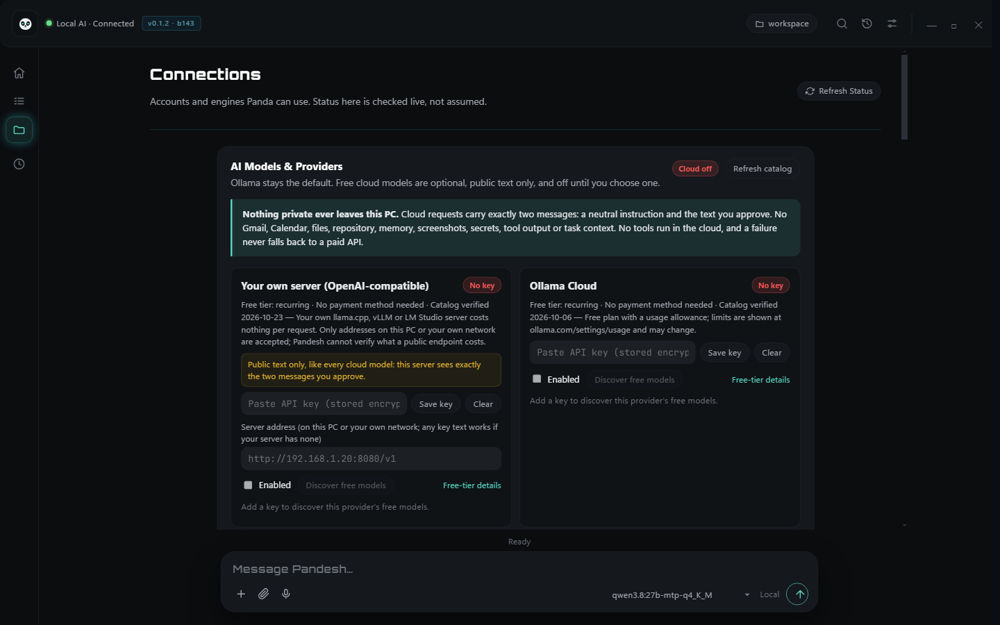
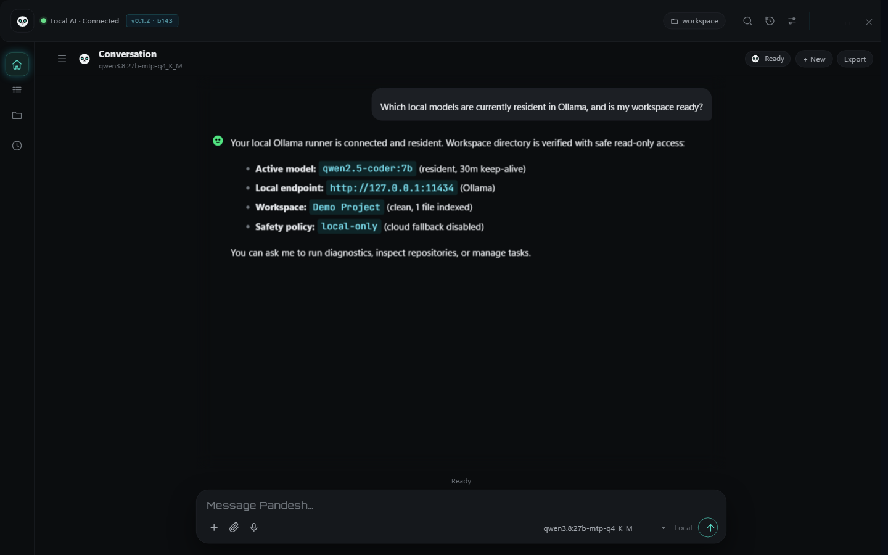
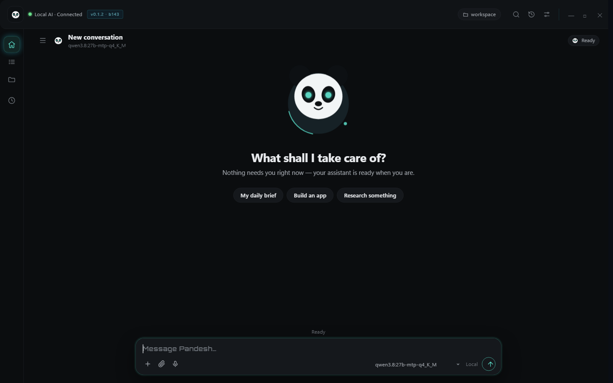

# Pandesh screenshots and demonstration

**Desktop UI preview — v0.1.2 Alpha, Build 143 (development build).** The [current public installer](https://github.com/siddharthakki/Pandesh_Releases/releases/tag/v0.1.1-pandesh-alpha) is **v0.1.1 Build 142** and may look or behave differently.

These are actual captures of the Pandesh desktop interface containing **synthetic demonstration data and example responses**. They illustrate the layout; they do not independently prove that every displayed diagnostic, model lookup, approval or file operation executed. In particular, the demo chat content mentions one model while the interface shows another selected model, and the diagnostic response describes sample hardware. We do not present either as verified runtime telemetry.

[Download the public alpha](https://github.com/siddharthakki/Pandesh_Releases/releases/tag/v0.1.1-pandesh-alpha) · [Getting started](GETTING_STARTED.md) · [Architecture diagram](https://github.com/siddharthakki/Pandesh/blob/main/docs/ARCHITECTURE.md) · [Roadmap](https://github.com/siddharthakki/Pandesh/blob/main/docs/ROADMAP.md)

## Gallery

### 1. New conversation — Panda desktop

An empty-conversation UI with a pinned composer and local-model selector.

### 2. AI models and provider connections

Settings surface for local/OpenAI-compatible and optional cloud providers. The displayed LAN endpoint is demo configuration.

### 3. Conversation preview

A demonstration conversation about local-model availability. **The text's model name is not consistent with the displayed selected model; this is not reliable evidence of live model selection.**

### 4. Diagnostics presentation

The view shows how a diagnostic result could be displayed. **Shown CPU/GPU/runtime values are sample data, not independently confirmed telemetry.**

### 5. Approval request presentation

Example request for a proposed `package.json` edit with a visible diff and Approve/Reject controls. An approval screen does not by itself establish execution.

### 6. Tasks and results

Development-preview one-click Results tab and artifact cards, addressing the earlier excessively long scrolling layout.

## Video walkthrough

**Not yet uploaded.** The public v0.1.1 release currently has no walkthrough MP4 asset. An earlier storyboard is a production plan, not a completed video.

A verified video should capture a clean demo session, keep private applications and notifications out of frame, demonstrate an actual Ollama model response and real tool evidence, and clearly distinguish sample data from live system measurements. See the [source project](https://github.com/siddharthakki/Pandesh) for development and contribution information.
